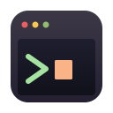
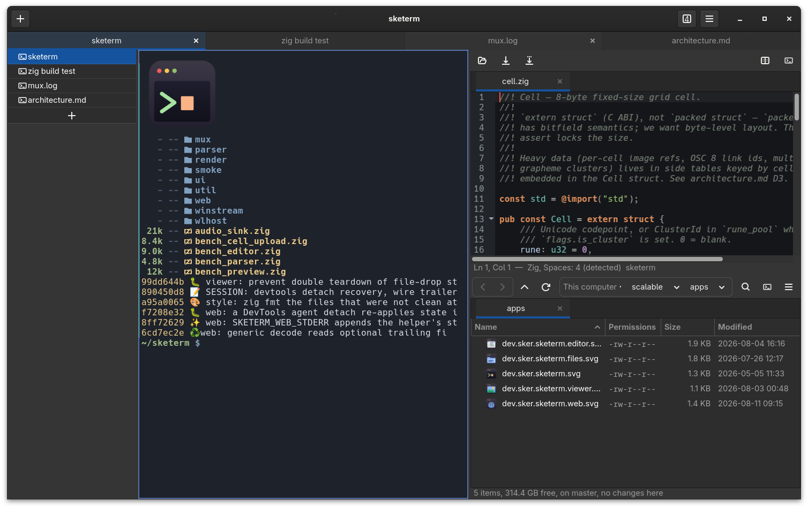
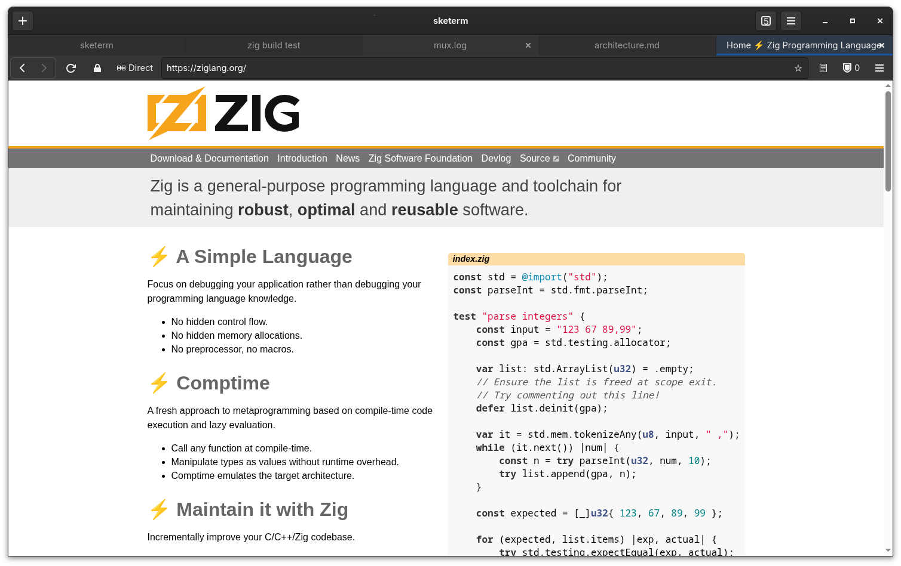

<p align="center">
  
</p>

<h1 align="center">sketerm</h1>

<p align="center">
  A GTK4 terminal emulator for Linux, written from scratch in Zig.<br>
  Your terminals run in a daemon, so they survive a restart and work the same over SSH.
</p>



## What it does

- **A real terminal.** Its own VT parser and OpenGL renderer: no VTE, no
  vendored terminal core. Truecolor, Sixel / Kitty / iTerm2 images, the Kitty
  keyboard protocol, OSC 8 hyperlinks, OSC 52 clipboard, bidi and complex-script
  shaping, IME, and CRT-style shaders if you want them.
- **Tabs, splits, layouts.** Tree-style tab sidebar, nestable splits with zoom,
  a command palette, a Quake-style dropdown, and layouts that save and restore
  (`sketerm --restore`).
- **Sessions that outlive the window.** Every terminal belongs to the
  `sketerm-mux` daemon. Close or crash the GUI and your shells keep running;
  open it again and they are still there.
- **Remote shells that reconnect.** `sketerm ssh <host>` opens a shell on the
  host's own daemon. It survives disconnects and roams between networks over
  encrypted UDP, falling back to plain SSH when UDP is blocked.
- **Remote and headless GUI apps.** `sketerm app <host> <cmd>` runs a GUI app
  on another machine and shows its windows here. `sketerm run <cmd>` runs one
  with no screen at all, as an Xvfb replacement.
- **Find your way around.** Scrollback search with regex, hint mode for
  opening links and paths by keyboard, copy mode, and jumping between shell
  prompts (zsh, fish and bash are integrated automatically).

## More than a terminal

A pane does not have to be a shell. The same window can hold a file manager,
a text editor, an image viewer or a web browser, and each also runs as its own
desktop application.

| Command | What you get |
| --- | --- |
| `sketerm files [path]` | File manager, local or `host:/path` |
| `sketerm edit [files]` | Editor with Tree-sitter highlighting, multiple carets and LSP |
| `sketerm web [url]` | Chromium-based browser (optional, via CEF) with an ad filter, reader mode and per-tab routing (direct, Tor, or through an SSH host) |
| `sketerm view [images]` | Image viewer |
| `sketerm play <file.cast>` | asciicast player |

`sketerm files` and `sketerm edit` take `--here` to turn the pane you are
typing in into that view, or `--tab` to open it as a tab. Browser tabs and
splits are in the command palette.



## Scripting and AI assistants

`sketerm cli` controls a running window from a script: list panes, send keys,
read the screen, split, take screenshots.

`sketerm mcp` is a [Model Context Protocol](https://modelcontextprotocol.io)
server. It lets an assistant such as Claude Code use terminals, drive GUI apps
headlessly, browse, and move files, while you watch (or take over) from your
own window. See [docs/mcp.md](docs/mcp.md).

## Install

You need Zig 0.16 or 0.17 and the development packages for GTK 4.14+,
libadwaita, FreeType, HarfBuzz, Fontconfig, FriBidi, libepoxy and libvpx.

```bash
git clone https://github.com/skerit/sketerm
cd sketerm/dist
./install.sh            # Arch: pacman package. Debian/Ubuntu: .deb. Otherwise: /usr/local
```

`./install.sh --deps` installs the build dependencies first (except Zig on
Debian/Ubuntu). `./install.sh --mux-only` installs just the daemon, which
needs nothing but libc: that is all a server needs for `sketerm ssh`.

To try it without installing:

```bash
zig build
zig-out/bin/sketerm
```

The browser is opt-in: `zig build fetch-cef && zig build web`.

There is also a macOS port, see [docs/macos.md](docs/macos.md).

## Configuration

Settings live in `~/.config/sketerm/config.conf` and apply as soon as you save.
There is a preferences dialog (`Ctrl+,`), an annotated
[sample config](data/sample.conf) and a [full reference](docs/config.md).

| Shortcut | Action |
| --- | --- |
| `Ctrl+Shift+T` / `W` | New tab / close tab |
| `Ctrl+Shift+D` / `R` | Split horizontal / vertical |
| `Ctrl+Shift+Left` / `Right` | Move focus between panes |
| `Ctrl+Shift+P` | Command palette |
| `Ctrl+Shift+F` | Search scrollback |
| `Ctrl+Shift+E` | Hint mode |
| `Ctrl+Shift+Up` / `Down` | Previous / next prompt |
| `Ctrl+Shift+Alt+B` | Tab sidebar |

Every binding can be changed. `sketerm --help` lists all of them.

## Documentation

- [Configuration](docs/config.md)
- [Remote sessions](docs/REMOTE.md)
- [Headless displays](docs/display.md)
- [MCP tools](docs/mcp.md)
- [Supported escape sequences](docs/protocols.md)
- [Architecture](docs/architecture.md) and [testing](docs/testing.md), if you want to hack on it

## License

GPL-3.0-or-later, see [LICENSE](LICENSE). Bundled shader presets and the
vendored Tree-sitter runtime carry their own compatible licenses
([shaders](data/shaders/README), [Tree-sitter](vendor/tree-sitter/PROVENANCE.txt)).
